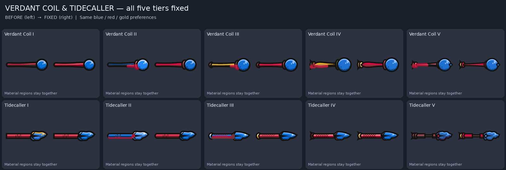
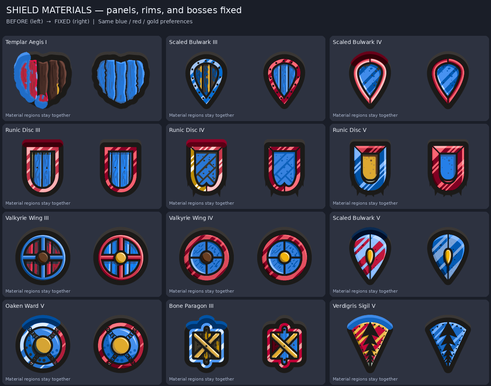

# Gear visual views

All 99 gear assets, rendered from the bundled PNGs, material masks, and region tones using the current shared recolor math. Every tile shows the original on the left and recolored example on the right. Staves and shields show eight sets in rows and tiers I–V across columns.

The example palette uses blue Primary, red Secondary, gold Trim, brown Leather, and cyan Emissive. Material names appear under each tile. These are texture/material review renders; fitting and human visual approval remain separate checks.

Regenerate with `python3 -I tools/modular_assets/gear_recolor_review.py`.

> **Which masks these are (asset pass v6).** The tiles above show the *shipped* gear masks, made by the `chroma-cells-v5` algorithm
> (the v5 pass: `gear_masks_chroma.py`). The "Before and after" section below is PR #11's record of its own pass: it compares
> the earlier clustering masks with `authored-surfaces-v1` (`gear_materials.py`), which is still in the repo and still tested,
> and can be shipped again with `held_gear.py --masks-only --algorithm authored-surfaces-v1`. See the README for how the two differ.

## Before and after the gear-mask fix

All 99 masks now use authored material boundaries instead of color clustering. These comparisons use the exact prior masks from commit `35819112018927206952159dfc4426487ac055c6` and identical blue/red/gold preference values. See [the fix details](gear-recolor-fixes.md).

Full comparisons: [40 staves](verification/gear_fix_staffs_all.png), [40 shields](verification/gear_fix_shields_all.png), [8 signature weapons](verification/gear_fix_signature_all.png), [11 store items](verification/gear_fix_store_all.png).

## Eight signature weapons

## Forty staves

## Forty shields

## Nine store weapons and two named shields

