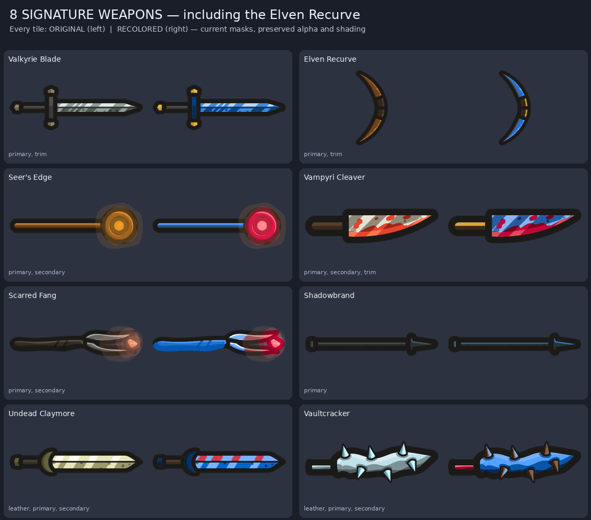
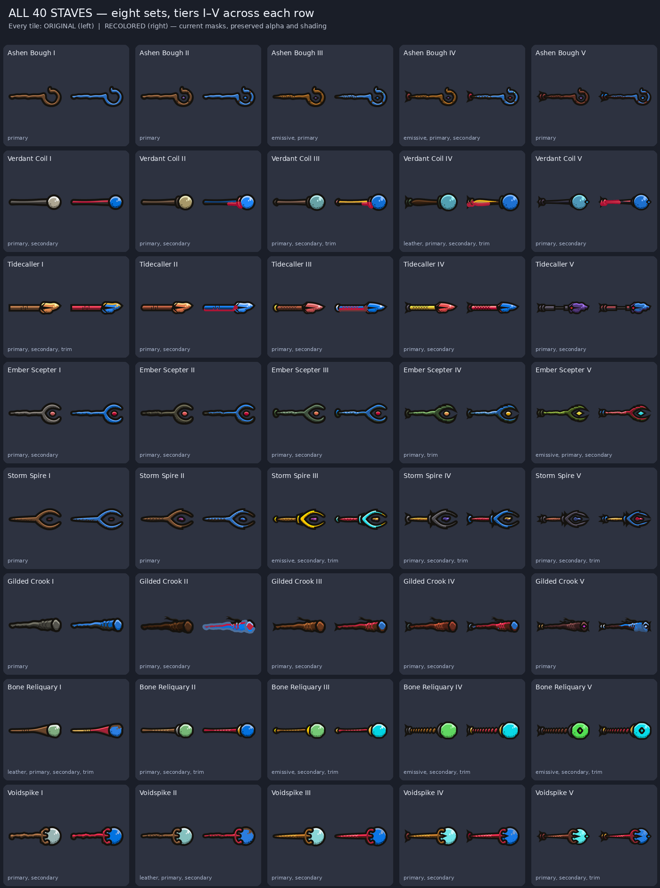
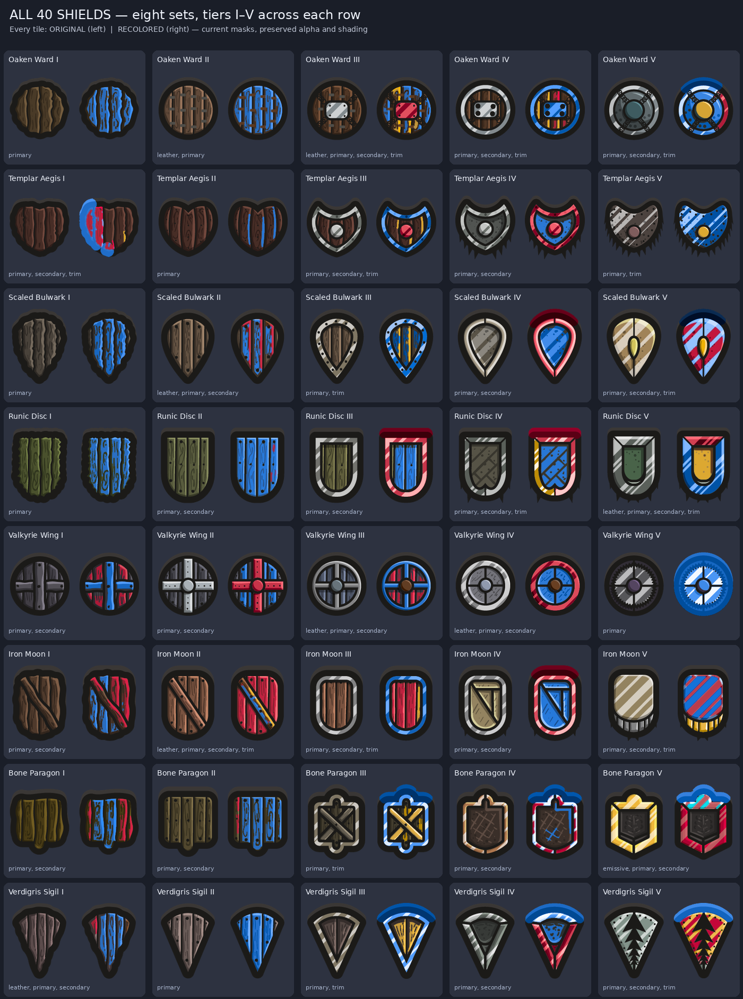
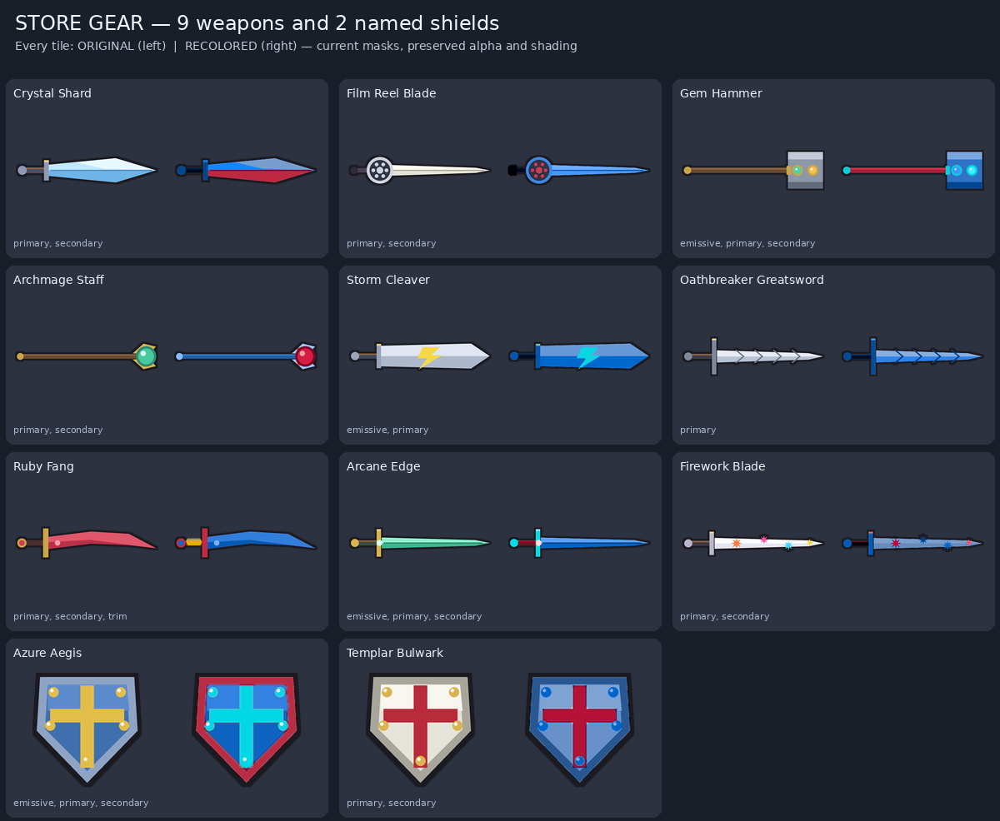

# Gear visual views

All 99 gear assets, rendered from the bundled PNGs, material masks, and region tones using the current shared recolor math. Every tile shows the original on the left and recolored example on the right. Staves and shields show eight sets in rows and tiers I–V across columns.

The example palette uses blue Primary, red Secondary, gold Trim, brown Leather, and cyan Emissive. Material names appear under each tile. These are texture/material review renders; fitting and human visual approval remain separate checks.

Regenerate with `python3 -I tools/modular_assets/gear_recolor_review.py`.

## Eight signature weapons

## Forty staves

## Forty shields

## Nine store weapons and two named shields

